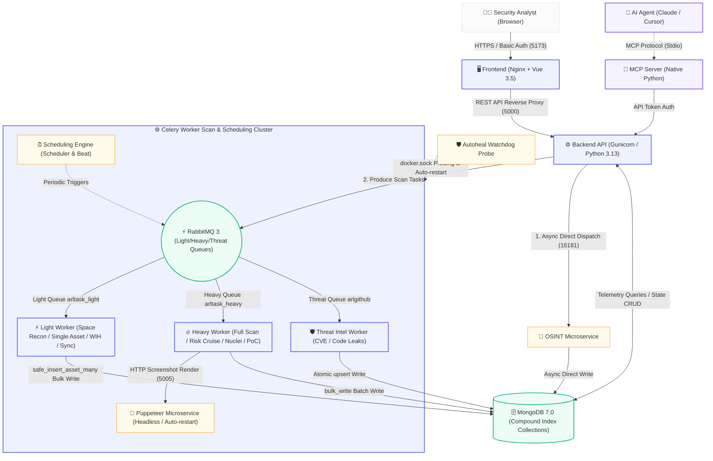

<div align="center">

  <p>
    <b>English</b> |
    <a href="./README.md"><b>简体中文</b></a>
  </p>

  # ARL-Next
  **Modern Attack Surface Reconnaissance & Vulnerability Monitoring Platform**

  *Modern Attack Surface Reconnaissance & Asset Intelligence Platform*

  <p><b>Enterprise Asset Correlation · Asynchronous Decoupled Scheduling · Native MCP Protocol Integration · Containerized Out-of-the-Box Deployment</b></p>

  <p>
    <a href="https://github.com/owl234/ARL-Next/releases"></a>
    <a href="https://github.com/owl234/ARL-Next/stargazers"></a>
    <a href="https://github.com/owl234/ARL-Next/network/members"></a>
    <a href="./LICENSE"></a>
  </p>

  <p>
    
    
    
    
    
    
  </p>

  <p>
    <a href="#quick-deploy"><b>⚡ Quick Deployment</b></a> •
    <a href="#comparison"><b>💡 Architectural Comparison</b></a> •
    <a href="#core-features"><b>✨ Core Features</b></a> •
    <a href="./mcp-server/README_en.md"><b>🤖 MCP Guide</b></a> •
    <a href="./CHANGELOG.md"><b>📜 Changelog</b></a> •
    <a href="./LICENSE"><b>📄 License</b></a>
  </p>
</div>

<br/>

---

## 💡 What is ARL-Next?

> **ARL-Next** is an asset reconnaissance and attack surface management platform re-engineered and continuously evolved from the classic open-source project ARL (Asset Reconnaissance Lighthouse).
> Addressing engineering bottlenecks in large-scale scanning scenarios—such as task queue congestion, continuous memory accumulation during prolonged execution, and legacy dependency debt—the system implements microservice decoupling and asynchronous task isolation. It aligns with modern runtime environments and mapping toolchains while integrating the standard **Model Context Protocol (MCP)** to facilitate automated asset profiling and collaborative AI security workflows.

---

### <span id="comparison"></span>💡 Architectural Evolution & Benchmark Comparison

| Evaluation Dimension | Legacy ARL Architecture & Implementation | ARL-Next Re-engineered Architecture |
| :--- | :--- | :--- |
| **Concurrency & Task Scheduling** | All scan tasks shared a single Celery queue, causing frequent queue stalling and process hangs under high concurrency | **Decoupled OSINT and screenshot capture into dedicated microservices**; implemented dual-track light/heavy task queues and bulk database persistence to resolve concurrency bottlenecks |
| **Automation Protocol Integration** | Lacked standardized external integration interfaces; restricted to manual Web UI interactions | **Built-in native Python MCP Server**, providing standard protocol endpoints for 13-dimensional panoramic asset profiling and aggregated telemetry |
| **Enterprise Asset Topology** | Lacked organizational equity mapping and multi-tier digital asset drill-downs | **Unified Asset Group Management**: correlates corporate equity with full-spectrum ICP registrations (websites, APPs, mini-programs, quick apps) to construct hierarchical group topologies |
| **Containerization & Delivery** | Outdated dependencies lacking mirror acceleration; vulnerable to network disruption during installation | **Multi-stage Docker builds with pre-compiled artifacts on Alibaba Cloud ACR**, enhancing build reliability and rapid container deployment |
| **Runtime Environment Baseline** | Python 3.6 / Vue 2 / MongoDB 3.x / Nmap 7.70 | **Python 3.13 / Vue 3.5 / MongoDB 7.0 / Nmap 7.95 Stable**; fully upgraded to a modern, actively supported runtime baseline |
| **Sensitive Data Extraction** | Relied on external Go binaries with cross-platform build and runtime overhead | **Pure-Python streaming extraction engine**, eliminating external binary dependencies for sensitive credential and file leak discovery |
| **Web UI / User Experience** | Long tables lacked sticky headers, pagination states were lost on refresh, and policy menus were fragmented | **Sticky table headers and floating action bars**, local pagination state persistence, and a modern 3-pane dictionary manager |
| **Threat Intelligence Integration** | Lacked continuous intelligence feeds; unaligned timestamps led to redundant alerts | **Automated CVE synchronization & GitHub credential leak monitoring**, deduplicated via database atomic upsert locks with strict timezone normalization |

---

### <span id="core-features"></span>✨ Core Feature Matrix

* 🤖 **Native MCP Protocol Integration**: Built-in standard library-based MCP server enabling AI agents to inspect 13-dimensional asset intelligence and summary dashboards via standard protocol interfaces. (👉 [MCP Configuration Guide](./mcp-server/README_en.md))
* ⚙️ **Asynchronous Decoupled Scheduling**: Microservice isolation with dedicated queues and bulk MongoDB operations ensures stable execution under high-throughput scanning workloads.
* 🌐 **Hierarchical Asset Group Management**: Integrated corporate asset discovery supporting multi-tier organizational structures, full-spectrum ICP association, and unified attack surface mapping.
* 🔍 **Modern Reconnaissance Baseline**: Standardized on Nmap 7.95 Stable; native Python streaming engine for sensitive information and credential discovery.
* 🛡️ **Vulnerability & Leak Monitoring**: Continuous tracking of authoritative CVE feeds and automated GitHub credential leak monitoring with atomic lock deduplication.
* ⚡ **High Availability & Fault Tolerance**: Container health probes, readiness polling, automated container watchdog auto-restart, and seamless web-based updates.
* 📦 **Pre-built Container Images**: Pre-compiled multi-stage container images on Alibaba Cloud ACR minimize network latency and dependency installation failures.

---

## 📸 Interface Preview

* **Global Dashboard**: Real-time visualization of attack surface posture, active reconnaissance pipelines, vulnerability distribution, and threat feeds. Features CPU/memory/disk telemetry, task queue queues, security dispatch log streams, and TOP 5 Web technology fingerprints.
  
  <p align="center">
    
  </p>

<details open>
<summary><b>🖼️ Click to expand / collapse core application views</b></summary>

<br/>

* **Hierarchical Asset Groups & Panoramic Asset Profile**: Enterprise asset reconnaissance integrated into a unified grouping architecture. Supports multi-tier organizational hierarchy, corporate OSINT asset correlation, attack surface management (ASM), and 13-dimensional asset profile drill-downs.
  
  <p align="center">
    
  </p>
  
  <p align="center">
    
  </p>
  
  <p align="center">
    
  </p>
  
  <p align="center">
    
  </p>

* **Task Dispatch & Policy Scheduling**: Integrates Nuclei orchestration, 100+ dedicated vulnerability PoC plugins, and an 8,800+ Web technology fingerprint repository with end-to-end task lifecycle tracking.
  
  <p align="center">
    
  </p>
  
  <p align="center">
    
  </p>

* **Threat Intelligence & Credential Leak Radar**: Real-time surveillance of global CVE vulnerabilities and automated tracking of sensitive code or credential disclosures on GitHub.
  
  <p align="center">
    
  </p>

* **System Settings & Modern Wordlist Manager**: Modern 3-pane wordlist manager with instant file preview and health indicators, dynamic worker concurrency scaling, and alert channel configurations.
  
  <p align="center">
    
  </p>

</details>

---

## 🏗️ Architecture Design

ARL-Next adopts a decoupled frontend-backend architecture with asynchronous distributed Celery task queues and lightweight microservices. The overall dataflow and component topology are illustrated below:



### Key Architectural Highlights:

1. 🖥️ **Presentation & Gateway (Frontend / Nginx)**: Built with **Vue 3.5 + Nginx**, featuring sticky table headers, floating action toolbars, and optional **Basic Auth gateway protection**.
2. ⚙️ **Core API & Protocol Integration (Backend / MCP)**: Powered by **Python 3.13 + Gunicorn**; features an embedded **native Python MCP Server** providing standard protocol interfaces and 13-dimensional asset profile exports.
3. 🧩 **Dedicated OSINT Microservice**: Dedicated asynchronous engine for corporate asset discovery and ICP lookup; directly invoked by the backend via coroutines to **prevent long-running OSINT tasks from stalling scan queues**.
4. ⚡ **Multi-Queue Worker Cluster**: Segregated into **lightweight**, **heavyweight**, and **threat intelligence** task queues; controls worker memory growth through subprocess lifecycle recycling; standardizes on **Nmap 7.95 Stable**.
5. 🛡️ **Microservices & Autoheal Watchdog (Puppeteer / Autoheal)**: Containerized headless browser isolation with request-count recycling; **Autoheal watchdog periodically checks scan workers and automatically restarts unresponsive containers**; pure Python engine for streaming sensitive data discovery.
6. 🗄️ **High-Throughput Persistence (MongoDB 7.0)**: Migrated asset ingestion pipelines to `bulk_write` interfaces; compound unique indexes across core collections backed by a 1GB memory buffer pool to maintain scanning throughput and database stability.

---

## <span id="quick-deploy"></span>🚀 Deployment Guide

### Production Deployment (Recommended)

**Target Environments**: Public Cloud VMs (Ubuntu / Debian / CentOS / RHEL / Rocky Linux, etc.) or Enterprise Internal Servers.  
**Estimated Time**: ~**1–2 minutes** with existing Docker environment; ~**3–5 minutes** on a fresh bare-metal host.

**Key Operational Advantages**:
* 📦 **Out-of-the-Box Delivery**: Pre-built container images eliminate local toolchain compilation and dependency configuration.
* 🛡️ **Dual-Layer Security**: Bundled local SSL encryption with **frontline Basic Auth gateway protection**; core internal services isolated within a private Docker bridge network.
* 🔄 **One-Click Hot Updates**: Web console-driven upgrade triggers the background daemon to pull updated images and orchestrations automatically.
* 🩺 **Health Readiness Probing**: Integrated startup probe loops verify API readiness before allowing incoming traffic, preventing intermittent startup errors.

---

#### 🚀 Deployment Methods

##### Method 1: Git Clone Source Deployment (Recommended for Global / Standard Deployments)

> [!TIP]
> The `start-prod.sh` script automatically detects system dependencies. If Docker or Compose is missing, it installs and configures them with optimized kernel settings.

```bash
git clone --depth 1 https://github.com/owl234/ARL-Next.git && cd ARL-Next
chmod +x start-prod.sh
bash start-prod.sh
```

##### Method 2: Accelerated One-Liner via China Mirror (Alternative for Mainland China Servers)

For servers located in Mainland China, execute the chained command corresponding to your operating system to extract deployment files from the Alibaba Cloud ACR mirror and launch the service:

> [!TIP]
> `start-prod.sh` includes environment probes that configure Swap, install Docker / Docker Compose plugins, and tune kernel parameters on bare-metal systems.

**Ubuntu / Debian / UOS Systems**:
```bash
# 1. Install base tools and create directory
apt-get update && apt-get install -y docker.io openssl curl && \
(systemctl enable --now docker 2>/dev/null || service docker start 2>/dev/null || true) && \
mkdir -p ~/ARL-Next && cd ~/ARL-Next && \
# 2. Pull orchestration files from Alibaba Cloud ACR mirror and start
docker pull crpi-laul1izptqrf0tkf.cn-beijing.personal.cr.aliyuncs.com/owl234-arl-prod/arl-web:latest && \
docker rm -f arl-temp 2>/dev/null || true && \
docker create --name arl-temp crpi-laul1izptqrf0tkf.cn-beijing.personal.cr.aliyuncs.com/owl234-arl-prod/arl-web:latest && \
docker cp arl-temp:/code/start-prod.sh ./ && \
docker cp arl-temp:/code/docker-compose.prod.yml ./ && \
docker cp arl-temp:/code/updater ./ && \
docker cp arl-temp:/code/version.txt ./ && \
docker cp arl-temp:/code/CHANGELOG.md ./ && \
mkdir -p ./frontend && docker cp arl-temp:/code/frontend/default.conf.prod ./frontend/ && \
docker rm -f arl-temp && \
chmod +x start-prod.sh && bash start-prod.sh
```

**CentOS / RHEL / Alibaba Cloud Linux / TencentOS Systems**:
```bash
# 1. Install base tools, setup Docker, and create directory
yum install -y openssl curl && \
(command -v docker &>/dev/null || curl -fsSL https://get.docker.com | bash -s docker --mirror Aliyun) && \
systemctl enable --now docker 2>/dev/null || true && \
mkdir -p ~/ARL-Next && cd ~/ARL-Next && \
# 2. Pull orchestration files from Alibaba Cloud ACR mirror and start
docker pull crpi-laul1izptqrf0tkf.cn-beijing.personal.cr.aliyuncs.com/owl234-arl-prod/arl-web:latest && \
docker rm -f arl-temp 2>/dev/null || true && \
docker create --name arl-temp crpi-laul1izptqrf0tkf.cn-beijing.personal.cr.aliyuncs.com/owl234-arl-prod/arl-web:latest && \
docker cp arl-temp:/code/start-prod.sh ./ && \
docker cp arl-temp:/code/docker-compose.prod.yml ./ && \
docker cp arl-temp:/code/updater ./ && \
docker cp arl-temp:/code/version.txt ./ && \
docker cp arl-temp:/code/CHANGELOG.md ./ && \
mkdir -p ./frontend && docker cp arl-temp:/code/frontend/default.conf.prod ./frontend/ && \
docker rm -f arl-temp && \
chmod +x start-prod.sh && bash start-prod.sh
```

---

#### 🔑 Access & Default Credentials

After deployment completes, open your browser and navigate to: `https://<YOUR_SERVER_IP>:5173` (bypass the self-signed certificate warning on first visit).

| Authentication Layer | Default Username | Default Password | Description |
| :--- | :--- | :--- | :--- |
| **Layer 1: Nginx Basic Auth Gateway** | `admin` | `arl_next` | Prevents automated internet scanner brute-forcing. Disabled by default; can be toggled via the security switch in the top navigation bar. |
| **Layer 2: ARL-Next System Login** | `admin` | `arlpass` | Main platform admin account. Changing the default password upon initial login is strongly recommended. |

> [!TIP]
> - **Firewall & Security Groups**: Ensure port **5173** (TCP) is allowed in your cloud provider security groups and local firewall (e.g., `ufw allow 5173/tcp` or `firewall-cmd --permanent --add-port=5173/tcp && firewall-cmd --reload`).
> - **Custom SSL Certificates (Optional)**: Place your official certificates renamed as `arl.crt` and `arl.key` into the `ssl-certs/` directory, then re-run `bash start-prod.sh`.

---

### 🔄 Upgrading in Production

ARL-Next supports **One-Click Hot Updates via Web Console** as well as **Standard Terminal Upgrades**:

#### Option 1: Web Console One-Click Update (Recommended)

Log in to ARL-Next ➔ Navigate to **"System Settings"** ➔ Click **"One-Click System Update"**.<br/>
The host update daemon pulls the latest images, synchronizes orchestration scripts, and performs service health checks in the background without requiring SSH access.

#### Option 2: Standard Terminal Upgrade

Navigate to your ARL-Next installation directory on the server and run the upgrade commands matching your installation method:

* **Git Clone Users (Method 1)**:
  ```bash
  cd ~/ARL-Next && git pull && sudo bash start-prod.sh
  ```

* **One-Liner / Container Sync Users (Method 2)**:
  ```bash
  cd ~/ARL-Next && \
  docker pull crpi-laul1izptqrf0tkf.cn-beijing.personal.cr.aliyuncs.com/owl234-arl-prod/arl-web:latest && \
  docker run --rm -v $(pwd):/host crpi-laul1izptqrf0tkf.cn-beijing.personal.cr.aliyuncs.com/owl234-arl-prod/arl-web:latest bash -c "cp /code/start-prod.sh /host/start-prod.sh && cp /code/docker-compose.prod.yml /host/docker-compose.prod.yml && mkdir -p /host/updater && cp -r /code/updater/. /host/updater/ 2>/dev/null || true; mkdir -p /host/frontend && cp /code/frontend/default.conf.prod /host/frontend/default.conf.prod 2>/dev/null || true; cp /code/version.txt /host/version.txt 2>/dev/null || true; cp /code/CHANGELOG.md /host/CHANGELOG.md 2>/dev/null || true" && \
  sudo bash start-prod.sh
  ```

> [!TIP]
> **Upgrade Safeguards**:
> - **Incremental Database Schema Evolution**: Automatically preserves collection structures and compound unique indexes, mitigating upgrade conflicts.
> - **Image Backup Tags**: Tags existing running images with `backup-stable` prior to pulling new images, allowing quick rollback in case of runtime anomalies.
> - **Readiness Probing**: Validates API responsiveness dynamically before releasing traffic.

---

## 🔌 API Calling Conventions

- Backend endpoints are prefixed with `/api`; interactive Swagger documentation is available at `/api/doc`. Paths are relative to your deployment address, e.g., `https://<your-arl-host>:5173`.
- When platform authentication is enabled, provide the request header `Token: <your-token>`. The backend also accepts `?token=` as a query parameter, but headers are strongly recommended to keep credentials out of access logs and browser history. **Never commit tokens into public issues, logs, or command histories.**
- If platform authentication is disabled, endpoints do not validate tokens; review your gateway and access control policies when exposing to external networks.
- API responses utilize business fields `code` and `message`; an HTTP 200 response alone does not indicate operational success.

### Task Operations (Note HTTP Methods)

| Operation | Method & Path | Parameters |
| :--- | :--- | :--- |
| Query Tasks | `GET /api/task/` | Optional query params: `target`, `status`, `page`, `size` |
| Stop Single Task | `GET /api/task/stop/<task_id>` | Task ID in path; **note that this GET request modifies task state** |
| Batch Stop Tasks | `POST /api/task/batch_stop/` | Request body per Swagger documentation |
| Delete Task | `POST /api/task/delete/` | JSON: `{"task_id": ["<task_id>"], "del_task_data": false}` |
| Restart Task | `POST /api/task/restart/` | JSON: `{"task_id": ["<task_id>"]}` |

The deletion endpoint only accepts tasks in `done`, `stop`, or `error` states; other states return business code `104` ("Task is currently running"). If deletion is required, verify the status, terminate the task via the stop endpoint if necessary, and then issue the deletion call. Stopping a task uses **GET** in the current implementation; do not assume it is read-only, and avoid guessing endpoints like `DELETE /api/task/<id>` or `POST /api/task/stop/`.

### Query Result Namespaces

Task-scoped results are queried under endpoints such as `/api/domain/`, `/api/ip/`, and `/api/site/`. Results synced to Asset Groups reside under the `asset_*` namespace, including `/api/asset_domain/`, `/api/asset_ip/`, and `/api/asset_site/`. These represent distinct datasets: task queries require `task_id`, whereas asset group queries require `scope_id`. Refer to `/api/doc` for current parameter specifications and pagination schema.

---

## ❓ FAQ & Troubleshooting

<details open>
<summary><b>Q1: Browser warns "Your connection is not private / Not Secure" on first HTTPS access?</b></summary>
<br/>

**A:** The system generates a local self-signed SSL certificate upon first startup.
- Click **"Advanced" ➔ "Proceed to (unsafe)"** in your browser to continue (in Chromium browsers, typing `thisisunsafe` on the error page will bypass the warning).
- **Configure Custom Domain Certificates**: Rename your commercial certificate files to `arl.crt` and `arl.key`, place them into the `ssl-certs/` directory, and run `bash start-prod.sh` to apply.
</details>

<details>
<summary><b>Q2: What should I do if I forget the admin password or Basic Auth credentials?</b></summary>
<br/>

**A:** Execute the following commands on the server terminal to reset credentials:
- **Reset Platform Admin Account (admin / arlpass)**:
  ```bash
  docker exec -it arl-web-prod /code/backend/.venv-docker/bin/python3 /code/backend/inject_user.py --reset
  ```
  > [!NOTE]
  > The platform protects existing passwords on startup by default. Adding `--reset` forces the `admin` password back to `arlpass`. Run this within a trusted host shell.
- **Reset or View Basic Auth Credentials**: Edit `frontend/.htpasswd` in your deployment directory, or toggle the Basic Auth switch in the web top navigation bar after logging in.
</details>

<details>
<summary><b>Q3: Web console displays <code>[ERROR] Trigger update failed</code> when clicking "One-Click System Update"?</b></summary>
<br/>

**A:** This typically occurs when the host updater daemon is inactive. Resolve via either of the following methods:
- **Method 1 (Recommended)**: Perform a manual terminal upgrade:
  ```bash
  cd ~/ARL-Next && sudo bash start-prod.sh
  ```
- **Method 2**: Restart the updater service and retry from the Web console:
  ```bash
  sudo systemctl restart arl-updater.service
  ```
</details>

<details>
<summary><b>Q4: How do I adjust scan concurrency under high workload volume?</b></summary>
<br/>

**A:** ARL-Next supports **dynamic live concurrency tuning** without restarting containers:
- Log in to the web console ➔ Navigate to **"System Settings"**;
- Adjust **Light Task Concurrency** (Space reconnaissance, single asset updates, WIH leak extraction, data synchronization), **Heavy Task Concurrency** (Domain/IP port scanning, risk cruising, Nuclei / PoC pipelines), and **OSINT Concurrency**; save changes for instant application.
</details>

<details>
<summary><b>Q5: Quick reference commands for Docker container maintenance and log inspection?</b></summary>
<br/>

```bash
# Check container statuses and health probes
docker compose -f docker-compose.prod.yml ps

# Inspect scan worker execution logs in real time
docker compose -f docker-compose.prod.yml logs -f arl-worker

# Gracefully restart all services
docker compose -f docker-compose.prod.yml restart
```
</details>

---

## 📜 Changelog

For detailed version history, feature additions, performance enhancements, and bug fixes, refer to ➔ [**CHANGELOG.md**](./CHANGELOG.md)

---

## 🤝 Acknowledgements

ARL-Next stands on the shoulders of giants. Special thanks to the following projects and teams:

* **Core Architecture**: Re-engineered from the open-source project [ARL (Asset Reconnaissance Lighthouse)](https://github.com/TophantTechnology/ARL), with architectural references from [Aabyss-Team/ARL](https://github.com/Aabyss-Team/ARL) and [adysec/ARL](https://github.com/adysec/ARL).
* **Fingerprint Data**: Special appreciation to the **Weiling Security Team** ( WeChat Official Account) for providing comprehensive Web technology fingerprint datasets.
* **Functional Inspirations**: Corporate OSINT modules reference [ICP_Query](https://github.com/HG-ha/ICP_Query); threat intelligence tracking incorporates designs from [github-cve-monitor](https://github.com/yhy0/github-cve-monitor).

ARL-Next remains dedicated to open-source collaboration, providing reliable tooling for offensive reconnaissance and defensive asset management.

---

## 💖 Sponsorship & Support

Continuous development of ARL-Next is supported by our open-source community. Special thanks to our sponsors:

<p align="center">
  
</p>

<p align="center">
  <a href="https://github.com/robotfish001" target="_blank">
    
  </a>
  <a href="https://github.com/phpmac" target="_blank">
    
  </a>
  <a href="https://github.com/123lpone" target="_blank">
    
  </a>
  <a href="https://github.com/Qexzi" target="_blank">
    
  </a>
</p>

---

## ⚠️ Legal Notice & Disclaimer

> [!CAUTION]
> **Compliance & Legal Terms**:  
> This platform is intended solely for authorized enterprise security assessments, SRC vulnerability research, academic defensive simulations, and lawful penetration testing. Before conducting any scanning or reconnaissance, operators must obtain explicit written authorization from target asset owners and strictly comply with applicable local laws and regulations (including the Cybersecurity Law of the People's Republic of China).  
> **Engaging in unauthorized scanning, intrusion, or destructive activities using this tool is strictly prohibited.** Operators assume full civil and criminal liabilities arising from unauthorized misuse. The authors and project contributors disclaim all liability for damages or legal consequences incurred through the use or misuse of this software.

---

## 📄 License

The ARL-Next project is licensed under the [GNU General Public License v3.0 (GPL-3.0)](./LICENSE).

* 🆓 **Free & Open Source**: Permitted for enterprise deployment, security research, asset mapping, and penetration testing, with full rights to read, modify, and customize source code.
* 🌐 **Copyleft & Share-Alike**: If you distribute modified versions or derivative works based on this project to third parties, you must release corresponding source code under the same GPL-3.0 license.
* ⚖️ **Attribution & Disclaimer Retention**: All distributions of source code must retain original copyright notices, license text, and disclaimer terms.

---

## 💬 Community & Feedback Channels

- 🐛 **Issue Reporting & Feature Requests**: Submit feedback via [GitHub Issues](https://github.com/owl234/ARL-Next/issues); tracked and reviewed regularly.
- 💡 **Discussions**: Engage in architecture and feature discussions via GitHub Issues and Discussions.
- 📢 **Chinese Community Channels**: Connect via WeChat or QQ group for asset mapping discussions and release updates.

<table align="center">
  <tr>
    <td align="center" style="padding: 10px 25px;"><b>👤 Personal WeChat</b></td>
    <td align="center" style="padding: 10px 25px;"><b>📢 WeChat Official (owl安全)</b></td>
    <td align="center" style="padding: 10px 25px;"><b>🐧 QQ Tech Group</b></td>
  </tr>
  <tr>
    <td align="center" style="padding: 10px 25px;"></td>
    <td align="center" style="padding: 10px 25px;"></td>
    <td align="center" style="padding: 10px 25px;"></td>
  </tr>
</table>

---

## 🌟 Star History

<div align="center">

<a href="https://www.star-history.com/?repos=owl234%2Farl-next&type=date&legend=top-left">
 <picture>
   <source media="(prefers-color-scheme: dark)" srcset="https://api.star-history.com/chart?repos=owl234/arl-next&type=date&theme=dark&legend=top-left&sealed_token=vNF3XBBUYjnOkZ1XfTODaJEURB73qlNr1zXyCH6HOUbJGKju3QmIb7pVDyjCK67Ra-ukzG7dgZ3B3HDpCKJ3raveN9bOCec7r6gDILhjGrYbcVEV2Gy5Ew" />
   <source media="(prefers-color-scheme: light)" srcset="https://api.star-history.com/chart?repos=owl234/arl-next&type=date&legend=top-left&sealed_token=vNF3XBBUYjnOkZ1XfTODaJEURB73qlNr1zXyCH6HOUbJGKju3QmIb7pVDyjCK67Ra-ukzG7dgZ3B3HDpCKJ3raveN9bOCec7r6gDILhjGrYbcVEV2Gy5Ew" />
   
 </picture>
</a>

</div>
